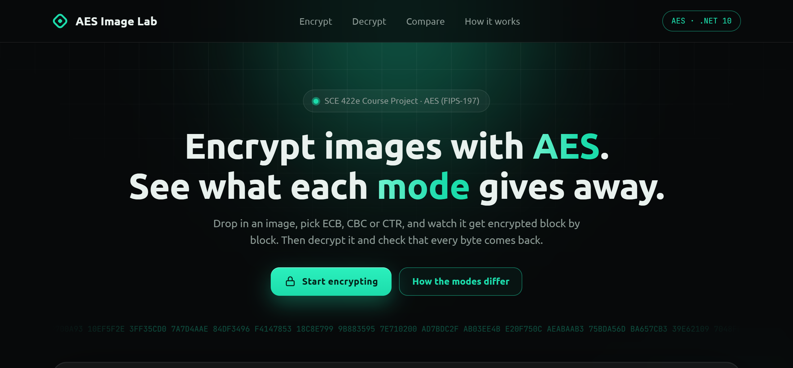
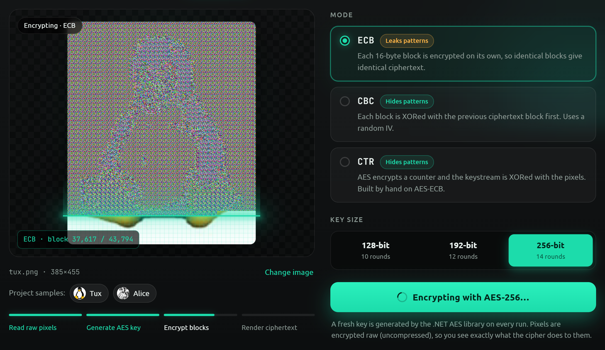
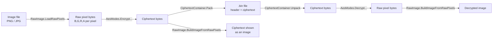
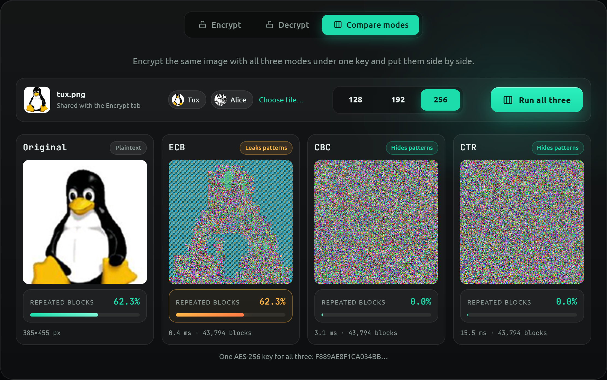

# AES Image Lab

Encrypt and decrypt images with **AES** in **ECB**, **CBC** and **CTR** modes, and see with your own eyes what each mode leaks.

Course project for **SCE 422e – System and Information Security**, built with **C# / .NET 10** (ASP.NET Core Razor Pages).

**Live demo:** https://aes-image-enc.runasp.net



---

## Contents

- [What the app does](#what-the-app-does)
- [Run it locally](#run-it-locally)
- [How it works](#how-it-works)
- [Project structure](#project-structure)
- [The core files explained](#the-core-files-explained)
- [The three modes at a glance](#the-three-modes-at-a-glance)
- [Results](#results)
- [Who explains what](#who-explains-what)
- [Questions the instructor may ask](#questions-the-instructor-may-ask)

---

## What the app does

| Tab | What you do | What you get |
|---|---|---|
| **Encrypt** | Pick an image (or the Tux / Alice samples), a mode and a key size, press **Encrypt** | The ciphertext drawn as an image, a plaintext/ciphertext slider, the generated key and IV/nonce, the share of repeated blocks, and a `.bin` file to download |
| **Decrypt** | Load a `.bin` file, choose the mode, paste the key and IV/nonce | The decrypted image, plus a byte-for-byte check if you attach the original. **Decrypt this** on the Encrypt tab fills everything in for you |
| **Compare modes** | Pick an image and press **Run all three** | The same image encrypted in ECB, CBC and CTR under one key, side by side |



The animations are only presentation. The real AES work happens on the server in C#; the browser animates while it waits for the answer.

---

## Run it locally

**Requirements:** Windows and the [.NET 10 SDK](https://dotnet.microsoft.com/download). Windows is required because image decoding uses `System.Drawing`, which is Windows-only.

```bash
dotnet run
```

Then open **http://localhost:5013**.

Run the automated self-test (70 checks, no browser needed):

```bash
dotnet run -- --selftest
```

---

## How it works



1. **Decode the image into raw pixels.** Every pixel becomes 4 bytes (blue, green, red, alpha). We encrypt these raw bytes, **not** the PNG file: PNG is compressed, and compression already hides the repetition that ECB leaks.
2. **Encrypt the bytes with AES** in the chosen mode, with a fresh key from the .NET library.
3. **Save the ciphertext** as a `.bin` file: an 8-byte header with the width and height, then the ciphertext. The key and IV/nonce are **not** stored in the file.
4. **Show the ciphertext as an image** by laying its bytes out as pixels of the same width and height. This is how we "open" an encrypted image.
5. **Decrypt** by reversing the steps with the same key, IV/nonce and mode.

---

## Project structure

```
AesImageWeb/
├── Crypto/
│   ├── AesModes.cs              ★ AES: key generation, ECB, CBC, hand-built CTR
│   └── BlockStats.cs              Share of repeated 16-byte blocks (the "leak meter")
├── Imaging/
│   ├── RawImage.cs              ★ Image ⇄ raw pixel bytes, ciphertext as an image
│   └── CiphertextContainer.cs   ★ The .bin file format (header + ciphertext)
├── Pages/
│   ├── Index.cshtml.cs          ★ Server handlers: Encrypt, Decrypt, Compare
│   ├── Index.cshtml               Page markup (tabs, controls, results)
│   └── Shared/_Layout.cshtml      Header, background, footer
├── Selftest/
│   └── SelfTest.cs                FIPS-197 test vector + round-trip tests
├── wwwroot/
│   ├── js/app.js                  Front end: uploads, animations, slider, hand-off
│   ├── css/site.css               Visual design and animations
│   └── samples/                   tux.png and alice.png from the project brief
├── Program.cs                     Starts the web app, or the self-test with --selftest
└── AesImageWeb.csproj             Project file (.NET 10, System.Drawing.Common)
```

★ = the heart of the project. If you only read four files, read these.

---

## The core files explained

### `Crypto/AesModes.cs` — the cryptography

Everything uses `System.Security.Cryptography.Aes`, the AES implementation built into .NET (on Windows it calls the operating system's CNG library). No third-party crypto.

| Method | What it does |
|---|---|
| `GenerateKey(keySizeBits)` | `Aes.Create()` → set `KeySize` (128/192/256) → `GenerateKey()`. The key comes from a cryptographically secure random number generator. |
| `CreateAes(key, mode, padding)` | One helper that configures every AES object: key, mode, padding. |
| `EncryptEcb` / `DecryptEcb` | `CipherMode.ECB` + `PaddingMode.PKCS7`, then `TransformFinalBlock`. |
| `EncryptCbc` / `DecryptCbc` | `CipherMode.CBC` + PKCS7. `GenerateIV()` makes a random 16-byte IV, which is returned next to the ciphertext. |
| `EncryptCtr` / `DecryptCtr` | **Built by hand**, because .NET's `CipherMode` has no CTR. Both call `CtrTransform`. |
| `CtrTransform` | For each 16-byte block: encrypt the counter block with AES-ECB (no padding) to get the keystream, XOR it with the data, then `IncrementCounter`. |
| `IncrementCounter` | Adds 1 to the 16-byte counter as a big-endian number, carrying into the next byte on overflow. |
| `GenerateRandomBlock` | 16 random bytes for the CTR nonce (the starting counter). |

Because XOR undoes itself, **CTR encryption and decryption are the same function**, and CTR needs **no padding**.

### `Imaging/RawImage.cs` — turning images into bytes and back

| Method | What it does |
|---|---|
| `LoadRawPixels(stream)` | Decodes the image with `System.Drawing.Bitmap`, converts it to 32-bit ARGB, and copies the pixel memory out with `LockBits`. Returns the bytes plus width and height. |
| `BuildImageFromRawPixels(bytes, width, height, forceOpaque)` | The reverse: writes bytes back into a bitmap. Used for the decrypted image **and** for drawing ciphertext as an image. |
| `SavePngToBytes(bitmap)` | Encodes a bitmap as PNG for the browser. |

Two details worth knowing:
- **Why 32-bit ARGB:** every pixel is exactly 4 bytes and rows have no padding, so the byte count is always `width × height × 4`, and one AES block (16 bytes) is exactly 4 pixels.
- **`forceOpaque`:** when ciphertext is drawn as an image, its alpha bytes are random, which would make the picture see-through. For display only, alpha is set to 255. The extra bytes added by PKCS7 padding (at most 16) don't fit the image and are not drawn. The real ciphertext is never changed.

### `Imaging/CiphertextContainer.cs` — the `.bin` file

Raw ciphertext has no width or height, unlike an image file, so the `.bin` adds a small header:

| Offset | Size | Content |
|---|---|---|
| 0 | 4 bytes | Width (little-endian `Int32`) |
| 4 | 4 bytes | Height (little-endian `Int32`) |
| 8 | rest | The ciphertext |

`Pack` builds the file and `Unpack` reads it. `Unpack` rejects files that are too short or whose width/height are not between 1 and 20,000, so a random file gives a clear error instead of a crash.

### `Pages/Index.cshtml.cs` — the server side of the page

Three POST handlers, called by the front end with `fetch` and answering in JSON:

| Handler | Input | Output |
|---|---|---|
| `OnPostEncryptAsync` | image, mode, key size | ciphertext preview, `.bin` (Base64), key, IV/nonce, block counts, repeated-block %, timing |
| `OnPostCompareAsync` | image, key size | the same for all three modes under **one** key |
| `OnPostDecryptAsync` | `.bin`, mode, key (hex), IV/nonce (hex), optional original image | decrypted image, timing, and `match` (true/false) if the original was attached |

It also validates input (mode, key length, hex format, image size up to about 4 megapixels) and turns failures into readable messages. For example, a wrong key in ECB/CBC breaks the PKCS7 padding check, and the user sees "the key, IV/nonce or mode doesn't match".

### `Crypto/BlockStats.cs` — the leak meter

`RepeatedBlockPercent` splits the data into 16-byte blocks and counts how many have appeared before. This turns "you can see the penguin" into a number (see [Results](#results)).

### `Selftest/SelfTest.cs` — proof that the crypto is right

Run with `dotnet run -- --selftest`. 70 checks:
- **1 known-answer test** from the AES standard (FIPS-197, Appendix C.3): the official AES-256 example must give exactly `8ea2b7ca516745bfeafc49904b496089`.
- **63 round trips:** 3 modes × 3 key sizes × 7 data lengths (0, 1, 15, 16, 17, 100, 1000 bytes; the odd sizes test padding).
- **6 image round trips:** Tux and Alice in all three modes must decrypt to identical pixels. Output images are written to `SelftestOutput/`.

### Front end: `Pages/Index.cshtml`, `wwwroot/js/app.js`, `wwwroot/css/site.css`

Pure presentation: tabs, drag and drop, the block-by-block canvas animation, the comparison slider, and the hand-off from Encrypt to Decrypt. One piece of logic worth knowing: when you load a `.bin` on the Decrypt tab, `app.js` draws the ciphertext as an image **in the browser** (`renderBinPreview`), so you can see a ciphertext before decrypting it.

---

## The three modes at a glance

| | ECB | CBC | CTR |
|---|---|---|---|
| Formula | `Cᵢ = E_K(Pᵢ)` | `Cᵢ = E_K(Pᵢ ⊕ Cᵢ₋₁)`, `C₀ = IV` | `Cᵢ = Pᵢ ⊕ E_K(N + i)` |
| In .NET | built in | built in | built by hand on AES-ECB |
| Padding | PKCS7 | PKCS7 | none (stream mode) |
| Extra value | none | random 16-byte IV | random 16-byte nonce |
| Identical plaintext blocks become | **identical** ciphertext blocks | different blocks | different blocks |
| Wrong key on decrypt | padding error (almost always) | padding error (almost always) | no error, just noise |
| Parallel? | yes | decryption only | encryption and decryption |



---

## Results

Both images from the project brief, encrypted with one AES-256 key:

| Image | Size | AES blocks (ECB/CBC · CTR) | Repeated blocks: plaintext | ECB | CBC | CTR | Decryption |
|---|---|---|---|---|---|---|---|
| Tux | 385 × 455 | 43,794 · 43,794 | 62.3% | **62.3%** | 0.0% | 0.0% | exact (3/3) |
| Alice | 343 × 592 | 50,765 · 50,764 | 55.6% | **55.6%** | 0.0% | 0.0% | exact (3/3) |

- **ECB keeps exactly the plaintext's repetition**, which is why the outlines stay visible.
- **CBC and CTR have no repeated blocks** and look like noise.
- Alice's pixel data (812,224 bytes) is an exact multiple of 16, so PKCS7 adds one whole extra block in ECB/CBC, while CTR needs no padding. That's why the block counts differ by one.

---

## Who explains what

The work is split by file, so each member can explain their part in the discussion:

| Role | Files | Be ready to explain |
|---|---|---|
| Cryptography | `Crypto/AesModes.cs` | Key generation, ECB/CBC in .NET, how and why CTR is built by hand |
| Image processing | `Imaging/RawImage.cs`, `Imaging/CiphertextContainer.cs` | Raw pixels vs PNG, how ciphertext is shown as an image, the `.bin` format |
| Interface | `Pages/Index.cshtml`, `wwwroot/js/app.js`, `wwwroot/css/site.css` | The three tabs, the animations, the Encrypt → Decrypt hand-off |
| Testing | `Selftest/SelfTest.cs`, `Crypto/BlockStats.cs` | The FIPS-197 test vector, round trips, the repeated-block measurement |
| Integration & report | `Pages/Index.cshtml.cs`, `Program.cs` | The server handlers, input validation and error messages, deployment, the report |

---

## Questions the instructor may ask

**Which library did you use, and why?**
`System.Security.Cryptography`, the cryptography library built into .NET. It's maintained by Microsoft, uses the operating system's tested AES implementation, and needs no third-party code.

**How is the key generated?**
`Aes.Create()`, set `KeySize`, then `GenerateKey()`. The bytes come from a cryptographically secure random number generator, and a new key is made for every encryption. We never type or hard-code a key.

**Why can you still see the penguin with ECB?**
ECB encrypts every 16-byte block independently with the same key, so identical plaintext blocks (like the large white background) always give identical ciphertext blocks. The shape of the repetition survives. Our measurement shows it: Tux has 62.3% repeated blocks before **and** after ECB encryption.

**Why didn't you just encrypt the PNG file?**
PNG is compressed, and compression removes repetition, so ECB would look as random as CBC and the comparison would show nothing. The result also couldn't be opened as an image. We encrypt the raw pixel bytes instead.

**How did you open the encrypted image?**
Ciphertext isn't a valid image file, so we treat its bytes as pixels of an image with the original width and height (4 bytes per pixel). For display only, the alpha byte is set to opaque. The server does this after encrypting, and the browser does it for any uploaded `.bin`.

**Why did you implement CTR yourself?**
.NET's `CipherMode` enumeration has no CTR. CTR is defined on top of the block cipher, so we built it exactly by the definition: encrypt a counter block with AES-ECB, XOR the result with the data, increment the counter, repeat.

**Why does CTR need no padding?**
It produces a keystream that is XORed byte by byte, so the last block can simply be shorter. ECB and CBC encrypt whole 16-byte blocks, so they pad with PKCS7.

**What is PKCS7 padding?**
If `n` bytes are missing to complete the last block, add `n` bytes each with the value `n` (for example, 3 missing bytes → `03 03 03`). If the data already fills the block exactly, a whole block of `16 × 0x10` is added, so padding can always be removed without ambiguity.

**What are the IV and the nonce? Are they secret?**
No, they aren't secret: they're shown next to the key and are needed for decryption. The **IV** makes CBC encrypt the same plaintext differently each time, and it must be unpredictable. The **nonce** is CTR's starting counter, and it must never repeat with the same key: reusing it reuses the keystream, and XORing two ciphertexts would cancel it out.

**Why does a wrong key give an error in ECB/CBC but not in CTR?**
In ECB and CBC, decrypting with the wrong key produces garbage, and the PKCS7 padding check at the end almost always fails, so .NET throws an error. CTR has no padding to check: XOR with the wrong keystream just gives noise. None of these modes detects tampering; that would need an authenticated mode such as AES-GCM.

**What's the difference between the key sizes?**
AES-128, AES-192 and AES-256 use 16, 24 and 32-byte keys and 10, 12 and 14 rounds. Bigger keys mean a much larger key space to brute-force, and AES-256 is our default. The block size is always 16 bytes.

**How do you know your AES is correct?**
The self-test reproduces the official AES-256 test vector from FIPS-197 exactly, and 69 round trips (data and both images, every mode and key size) all decrypt back to the original bytes.

**Why isn't the key stored in the `.bin` file?**
Anyone with the file would then be able to decrypt it. The file holds only the image size (not secret) and the ciphertext; the key and IV/nonce are kept separately.

**How do CBC and CTR differ in practice?**
CBC encryption is sequential because each block depends on the previous one, while CTR blocks are independent, so CTR can encrypt and decrypt in parallel and jump to any block. A flipped bit in CBC ciphertext garbles that whole block and flips one bit in the next; in CTR it flips only that one bit of the plaintext.

---

## Tech stack

- **.NET 10**, ASP.NET Core Razor Pages
- `System.Security.Cryptography` for AES
- `System.Drawing.Common` for image decoding and encoding (Windows)
- Plain JavaScript and CSS for the interface, with no front-end framework
- Hosted on MonsterASP.NET (free Windows hosting) and deployed with Web Deploy
